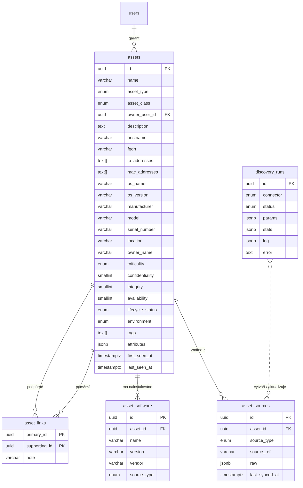

# Datový model – Asset

Zdroj pravdy: `apps/api/src/db/schema.ts`. Migrace: `apps/api/drizzle/`.

## Poznámky k návrhu

- `(source_type, source_ref)` je unikátní → idempotentní synchronizace.
- IP/MAC jako `text[]` s GIN indexem (rychlé hledání průniku); pro pokročilou práci se sítěmi lze přejít na `inet[]`.
- `attributes` (jsonb) pro data specifická pro zdroj (Wazuh skupiny, otevřené porty, CPU/RAM) – bez migrací.
- `asset_sources.raw` drží poslední surová data zdroje (diagnostika, budoucí AI analýza).
- CIA hodnocení 1–4 (nízká – kritická) – sladit s metodikou hodnocení rizik (modul Risk).

## Plánované vazby na další moduly

| Tabulka | Účel |
|---|---|
| `asset_relations (from_id, to_id, type)` | technické vztahy podpůrných aktiv: běží na / zálohuje |
| `process_assets (process_id, step_id?, asset_id, role)` | které procesy aktivum používají |
| `risk_assets (risk_id, asset_id)` | rizika vztažená k aktivu |
| `control_assets (control_id, asset_id)` | kontroly aplikované na aktivum |
| `asset_roles (asset_id, user_id, role)` | další role k aktivu – správce, uživatel (garant je `owner_user_id`) |
| `ai_suggestions` | návrhy AI ke schválení |

Identity a přístup (users, roles, groups, sessions, audit_log…) popisuje [authentication.md](../01_architecture/authentication.md).
